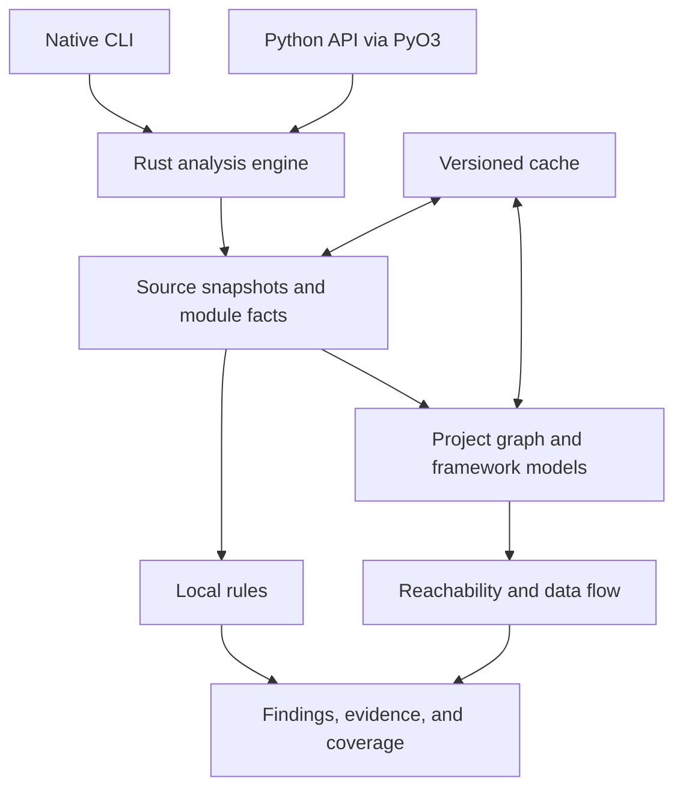

# Skarmory architecture

Status: accepted direction; implementation is at the initial scaffold stage.

Skarmory is a Python code analyzer powered by a shared Rust engine. Its first
analysis milestone is project-wide dead-code detection with explicitly tested
Skylos compatibility. Quality, secrets, security analysis, and developer
integrations follow on the same foundation.

This document describes the intended architecture. The scaffold does not yet
implement parsing, semantic analysis, caching, or Skylos-equivalent findings.
Commands that request unavailable analysis must report that limitation rather
than return an empty successful scan. Performance figures elsewhere in the plan
are engineering targets, not measurements of this repository.

## 1. Goals and scope

The initial engine should:

- Preserve useful Skylos behavior, including framework awareness, confidence,
  suppressions, evidence, and incomplete-analysis reporting.
- Keep the expensive static-analysis pipeline in Rust.
- Provide a native executable and an importable Python API over the same core.
- Produce deterministic results across worker counts and cache states.
- Make public API assumptions and dynamic-use uncertainty visible.
- Measure speed on equivalent, completed analysis workloads.

The initial compatibility reference is Skylos **5.7.0**, source commit
`87978e69adf91b3811e97b00c40aa39d7937cd94`. Compatibility is a versioned contract
for declared capabilities, not a promise to reproduce every current or future
Skylos command. Full-platform compatibility, other source languages, runtime
execution, network lookups, and LLM workflows require separate milestones.

Skylos already includes an experimental native extension for discovery, clone
comparison, coupling, and import cycles. Its documented analysis differences
make backend identity part of the reference environment. Skarmory's intended
contribution is an entire native Python analysis pipeline with measured
compatibility, rather than another collection of isolated accelerators.
[Skylos native extension](https://github.com/duriantaco/skylos/blob/87978e69adf91b3811e97b00c40aa39d7937cd94/rust/README.md)

## 2. Shared engine and frontends



The boundaries are logical components; they do not require a crate for each
individual subsystem.

| Component | Responsibility |
| --- | --- |
| `skarmory_core` | Project state, stable analysis facts, graphs, rules, evidence, and caching |
| `skarmory_python` | Python parser adapter and syntax-specific fact extraction |
| `skarmory_cli` | Arguments, output, and command-specific exit behavior |
| `skarmory_bindings` | PyO3 conversion and native API exposure |
| Python package | Typed interface, compatibility helpers, and optional integrations |
| Conformance harness | Reference comparisons and reviewed discrepancies |
| Benchmark harness | Reproducible timing, memory, coverage, and accuracy measurements |

The core must not depend on Python interpreter objects. It receives ordinary
native options and source inputs and returns native report data. CLI and SDK
adapters must not grow independent implementations of resolution or rules.

### Native command line

The intended installed `skarmory` command is a native executable. Startup,
argument parsing, scanning, and output should not require starting Python. The
initial scaffold builds that executable through Cargo separately from the
Python SDK wheel; installing the SDK does not yet install the native CLI. The
CLI maps engine outcomes into the selected output and gate policy; a finding
count alone does not determine every command's exit code.

### Python interface

The Python boundary should be coarse-grained:

1. Validate and extract arguments while attached to the interpreter.
2. Perform native analysis without accessing Python objects.
3. Reattach to construct a structured report or raise a structured error.

PyO3 documents detaching from the interpreter while native work runs. That is
the intended execution model, subject to the selected PyO3 release and tests.
The core must also be thread-safe independently of whether an interpreter has a
GIL. Concurrent scans need a coordinated resource budget.
[PyO3 parallelism](https://pyo3.rs/main/parallelism)

Per-node Python callbacks are outside the default fast path. Coarse progress
events can be buffered and delivered through an adapter. Arbitrary Python AST
visitors require an explicitly supported compatibility path; unsupported
visitors must never be ignored silently.

## 3. Input snapshot and file selection

Every report describes one declared analysis scope. Its identity includes the
project roots, selected paths, effective configuration, target Python version,
enabled rules, model versions, and relevant external evidence.

Discovery must handle multiple source roots, ordinary and namespace packages,
explicit files, exclusions, generated files, symlink policy, and source
encoding. Adopting a file-walking library does not make that library's default
ignore behavior the product contract. Compatibility fixtures must verify the
actual selected file set.

The initial implementation can discover files, read each selected source once,
and retain immutable source content or its derived facts for that scan. A
content fingerprint identifies the source used. A file changed during the scan
must not be represented by facts from one version and locations from another.
Detectable races should trigger bounded retry or an explicit incomplete result.
A persistent session must analyze an immutable generation rather than mutate a
graph that another scan is still reading.

Reading a project for static analysis does not import it or execute its package
configuration. Runtime tracing and tests are separate, explicitly requested
workflows. Source metadata and declared entry points should be interpreted
statically.

## 4. Python frontend and internal representation

Ruff's parser and AST crates are the preferred candidates for the initial
parser spike. Selection, exact versions, supported syntax, and performance must
be verified before treating the adapter as implemented. Ruff's official
versioning policy describes internal Rust interfaces as unstable, so parser
dependencies must be pinned together and upgraded intentionally.
[Ruff crate versioning](https://docs.astral.sh/ruff/versioning/#crate-versioning)

The adapter owns the dependency boundary. Ruff AST types must not become public
Python API types or the persistent cache format. The project also owns source
location conversion, including byte offsets, line/column conventions, and
Unicode behavior.

For each file, extract a compact module summary:

| Fact | Examples |
| --- | --- |
| Identity | Source root, module, path, content fingerprint |
| Scopes and bindings | Module, function, class, comprehension, closure, alias |
| Definitions | Functions, classes, members, imports, variables, parameters |
| Imports and exports | Relative imports, re-exports, finite `__all__`, star-import limits |
| References | Calls, values, types, callbacks, attribute access |
| Registration evidence | Decorators, configured hooks, framework object relationships |
| Uncertainty | Unknown receiver, dynamic target, missing source, unsupported syntax |
| Local findings | Findings and evidence from enabled file-local rules |

Use integer identifiers and interned names where useful. Symbol identity must
include module, lexical scope, binding, and definition identity. A simple name
such as `process` is a lookup key, not a globally unique symbol.

Parse once per source generation for the enabled analyses, share extracted
facts, and build expensive control-flow structures only when required. Release
full syntax trees when later work can use summaries. Additional passes are
allowed when semantics require them; avoiding redundant work is more important
than forcing every analysis into a single traversal.

## 5. Resolution, roots, and reachability

### Binding resolution

Resolution follows lexical bindings and import/export relationships. It must
account for shadowing, aliases, nested definitions, `global` and `nonlocal`,
relative imports, class receivers, inheritance, and modeled framework objects.
Unresolved relationships remain explicit.

For example, two modules can each define `process`. A call to one must not
automatically retain the other. Conversely, when the receiver truly is unknown,
the engine must preserve the uncertainty rather than invent a precise edge.

### References are edges, not entry points

```python
def old_a():
    old_b()

def old_b():
    old_a()
```

Both functions have references, but the group can be unreachable from every
recognized entry point. Traverse from roots and use strongly connected
components where useful for recursive groups and fixed-point computations.
Skylos already makes this distinction in its current implementation.
[Skylos reachability](https://github.com/duriantaco/skylos/blob/87978e69adf91b3811e97b00c40aa39d7937cd94/skylos/deadcode/reachability.py)

Root evidence can include module execution, package entry points, declared
external API, active framework registration, test discovery, plugin exports,
configured roots, and positive runtime evidence. Each root records its origin.

Module execution creates definitions without executing every function body.
The representation must distinguish declaration creation, value exposure, and
body execution. That distinction is also needed to reason about decorators,
default arguments, and class-body effects.

### Application and library policies

| Policy | Meaning |
| --- | --- |
| Library | Preserve declared or modeled externally consumed API surfaces |
| Application | Analyze use from the configured application entry points |
| Skylos compatibility | Follow the pinned reference policy |
| Custom | Use explicitly declared roots and public surfaces |

A library API with no callers in its own repository is not automatically dead.
An application policy must also state its source boundary; it cannot claim to
have analyzed consumers outside that boundary.

### Typed relationships

Keep runtime calls, value references, type references, imports, re-exports,
framework registration, test use, and uncertain dispatch distinguishable.

A type reference is not proof that a function body executes. It may still
require retaining an import or exported declaration. Code used only by tests
can be reported separately from production reachability; it must not silently
be reclassified as unused.

## 6. Framework and library models

Framework awareness is an analysis subsystem. Initial models should be chosen
from the pinned compatibility scope and verified through paired live/dead
fixtures. Skylos documents framework behavior and precise custom entry-point
selectors that form part of the reference contract.
[Skylos framework awareness](https://docs.skylos.dev/dead-code-detection)

Models must identify both the relevant API and its activation. Examples include
a mounted FastAPI router, a loaded Django signal module, a Pydantic validator,
a discovered pytest fixture, and a callback handed to a live executor.

Do not infer framework behavior solely from an unqualified name. A local
decorator named `validator` is not automatically Pydantic, and the existence of
an unmounted route declaration is not proof of an active endpoint.

Concurrency fixtures should include coroutine scheduling, task factories,
executor submissions, `multiprocessing.Process` targets, pool workers, and
framework task registration. Passing a function as a value can establish use
without a direct call expression at the registration site. Whether that use
proves execution or only possible invocation must remain distinguishable.

Version model data and include its identity in semantic cache keys. Prefer
declarative selectors and reviewed native handlers over importing arbitrary
project plugins. New native policies may improve precision, but compatibility
behavior must change through a reviewed, versioned decision.

## 7. Findings, uncertainty, and completeness

The engine must keep these outcomes distinct:

- Use is established by the available evidence.
- External or dynamic use is possible.
- No use was found under the declared analysis assumptions.
- Analysis of the relevant scope did not complete.

Missing files, parse failures, unsupported constructs, exhausted budgets, and
worker failures cannot become evidence of non-use. Compatibility mode must
preserve the reference's conservative completeness behavior. A future native
policy may localize uncertainty only when it can establish that unaffected
regions are independent.

Reports should contain findings, coverage, evidence, statistics, and policy
outcomes as separate fields. Proposed diagnostic information includes:

| Field | Requirement |
| --- | --- |
| Rule identity | Stable native ID and explicit compatibility mapping |
| Location | Defined path and range conventions tied to analyzed source |
| Symbol | Resolved identity when available |
| Severity | Impact category, separate from confidence |
| Confidence | Explainable heuristic policy and contributing factors |
| Evidence | Root, edge, source/sink path, or reason for uncertainty |
| Disposition | Reported, retained, suppressed, or abstained |
| Coverage | Completed work and specific limitations |

Confidence is initially a heuristic score, not a calibrated statistical
probability. Reproducing a legacy score does not make a finding with confidence
90 equivalent to a 90% probability that deletion is safe.

Sort output by stable fields before returning it. Worker completion order and
hash-table iteration must not affect findings, confidence, or baseline matching.
Machine formats have explicit schema versions and migrations. Presentation
filtering must not erase coverage limitations.

## 8. Caching and incremental analysis

### First implementation

Cache per-file facts and recompute project resolution and reachability from
those summaries. This captures much of the expensive frontend work while
keeping the correctness model small. Measure the global pass before attempting
incremental graph algorithms.

Cache identity includes the inputs actually used by that layer:

- Source content fingerprint and decoding policy.
- Parser and internal representation versions.
- Target Python language version.
- Effective semantic configuration and enabled analysis requirements.
- Framework and external API model versions.
- Source universe and import-resolution inputs.
- Relevant root and runtime-evidence identities.

Persist facts rather than an unversioned parser AST. Validate cache records and
write them atomically. A missing, corrupt, or incompatible record is a cache
miss; it must not alter analysis meaning.

### Dependency changes

A changed caller can make an unchanged callee dead. Deleting a root can make an
entire unchanged recursive group unreachable. Adding a module can change an
existing import from unresolved to resolved. Configuration changes can alter
both the file universe and roots.

Later incremental updates therefore need dependency-aware invalidation for
additions, removals, renames, exports, package roots, models, and uncertainty.
Update affected summaries and propagate until the required fixed point. A
file's unchanged text is insufficient evidence that its final findings remain
valid.

Cache raw facts before confidence and presentation filtering where practical.
A threshold-only change should not require reparsing, provided the underlying
semantic requirements did not change.

The invariant is:

> Cached and uncached analysis of the same project state produce equivalent
> normalized findings, evidence, and coverage status.

Test this invariant across worker counts and mutation sequences, including
changes to roots and previously missing imports. A persistent session also
needs bounded memory and a defined invalidation boundary between generations.

## 9. Parallelism and performance

Use bounded CPU parallelism for discovery, parsing, and file-local analysis.
Rayon is the initial candidate. Coordinate worker budgets across discovery,
parsing, nested work, and concurrent SDK scans rather than creating an
independent full-size pool for each stage.

Collect local facts without a single global graph lock, then merge them
deterministically. Start with straightforward graph algorithms and optimize
only measured costs. In particular, optimize repeated searches and candidate
generation without silently reducing the required analysis.

An async runtime is not required for the initial CPU-heavy engine. Tokio can be
evaluated later if an integration has a concrete transport or network need.
Rust work detached from Python still needs cancellation and resource limits.

Ruff's documented pipeline is a useful reference for parallel file analysis and
caching, but whole-project reachability adds dependencies beyond file-local
diagnostics. Ruff timing is a responsiveness reference; matched Skylos rules
and coverage are the behavioral performance comparison.
[Ruff compilation pipeline](https://docs.astral.sh/ruff/contributing/#compilation-pipeline)

Measure process startup, discovery, reading, parsing, resolution, reachability,
rule execution, serialization, CPU time, and peak memory. Separate cold analysis
cache, warm cache, edited-project, and resident-session measurements. Record
whether the operating-system page cache is warm.

## 10. Security analysis and cleanup extensions

Security analysis will reuse symbols, framework models, and project facts, with
its own declared coverage and budgets. The intended progression is local
operation checks, source/sink models, flow-sensitive function analysis,
function summaries, and bounded cross-function propagation.

Sanitizer models are context-specific. A transformation appropriate for HTML
does not establish safety for SQL or a shell. Unknown calls and exhausted
analysis budgets remain visible. Findings should retain explainable evidence
paths when the analysis can construct them.

Detection and automatic editing are separate contracts. Imports can have
effects; function defaults and decorators execute when a definition is created;
class creation can also have effects. An absent caller alone cannot authorize
removal.

Cleanup follows analysis maturity, with narrow eligibility, an exact preview,
source-fingerprint validation, syntax preservation, and separate tests of edit
behavior. Runtime tracing supplies positive observed-use evidence. Absence from
a trace does not prove a symbol is unused, and trace/source mismatches must be
handled explicitly.

## 11. Compatibility, APIs, and packaging

The compatibility adapter translates CLI arguments, configuration, rule IDs,
report shapes, and exit policy into and out of the native engine. It must not
reimplement the analysis in Python.

Skylos's pinned public `analyze(...)` returns a JSON string. An adapter claiming
that API must retain the return contract; Skarmory's typed report API is a
separate interface. Unsupported arguments or extensions are explicit errors.
[Skylos public analysis function](https://github.com/duriantaco/skylos/blob/87978e69adf91b3811e97b00c40aa39d7937cd94/skylos/analyzer.py)

Native configuration uses `[tool.skarmory]`. Reading legacy configuration must
be an explicit, versioned policy. Define precedence when native and legacy
settings coexist; do not combine them by accident. Existing Skylos discovery,
inheritance, suppressions, and selector behavior belong in conformance tests.
[Skylos configuration](https://docs.skylos.dev/configuration)

The initial packaging arrangement is a standard PyO3 SDK wheel built from
`crates/python_bindings`, exposing the extension as `skarmory._native`, plus a
separately built Cargo CLI. The native CLI is not bundled in that wheel.

The longer-term goal is one installation containing the native binary, PyO3
extension, Python API, and type information. This is an unresolved Phase 0
packaging spike. Maturin's target-selection documentation is not evidence that
its binding-selection machinery supports this combined layout automatically.
The separate binary/library packaging question must be tested with the pinned
build tools before promising a combined wheel.
[Maturin binary/library packaging discussion](https://github.com/PyO3/maturin/issues/368)

The spike must establish executable placement, whether the CLI depends on
Python at runtime, wheel size, source-distribution contents, and supported
interpreter/ABI combinations. Do not assume an ordinary ABI3 wheel covers every
free-threaded interpreter. A separate CLI distribution and SDK distribution is
an acceptable fallback if they have clear ownership and matching engine/schema
versions.

No package-registry reservation, published wheel matrix, stable API, parser
coverage, or performance result is implied by the initial scaffold.

## 12. Validation gates

Compatibility tests and correctness tests answer different questions. Compare
the pinned reference on declared features, and separately maintain reviewed
positive/negative semantic fixtures and an external holdout corpus.

Required gates include:

- No unexplained differences within a claimed compatibility surface.
- No regression in the curated symbols that must be retained or detected.
- Equivalent serial, parallel, cached, and clean results.
- Complete accounting for requested work that could not run.
- Deterministic machine output and stable schema behavior.
- Benchmarks that state the rules, files, coverage, environment, and differences.
- Installable artifacts on every advertised platform.

The first complete analysis slice is discovery, parsing, scoped symbols,
project reachability, and compatible dead-code JSON. It should establish both
semantic correctness and measured cost before broader rule-family expansion.

See [ADR 0001](adr/0001-native-engine.md) for the architectural decision and its
tradeoffs.
